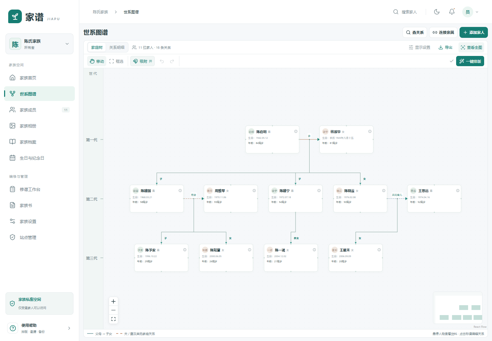
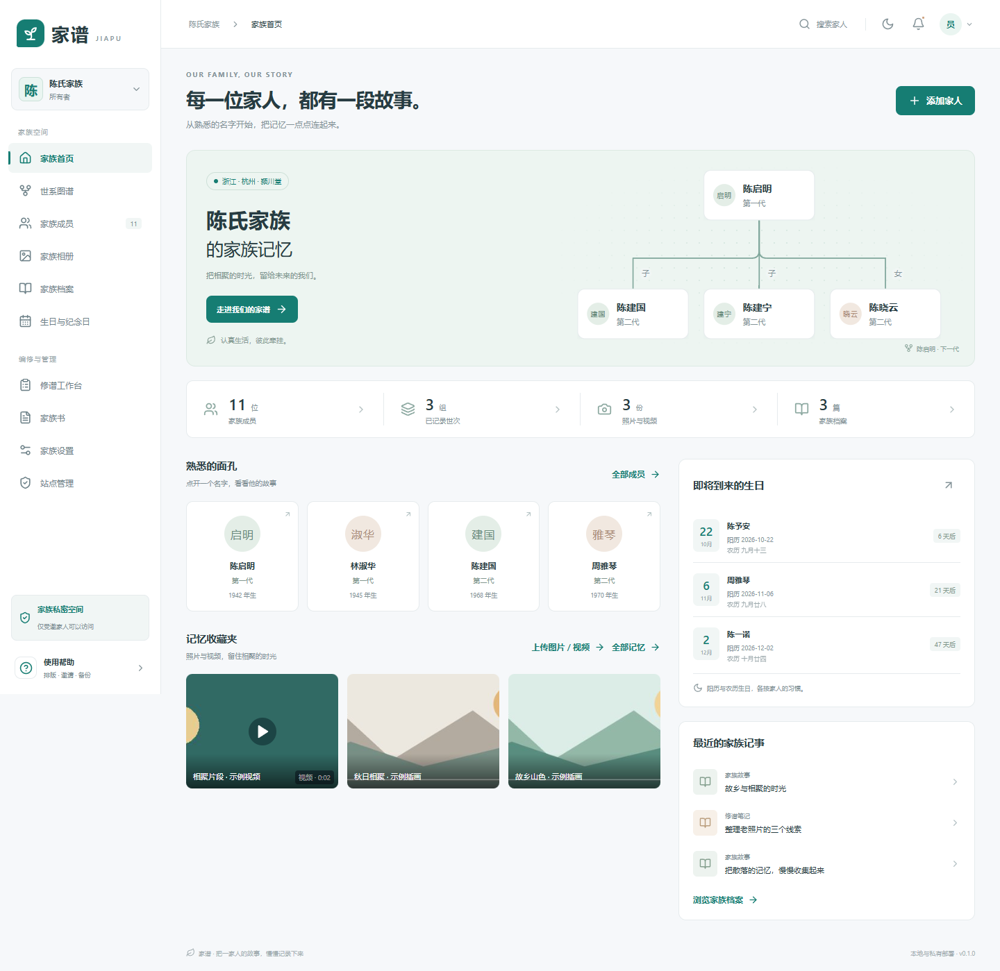
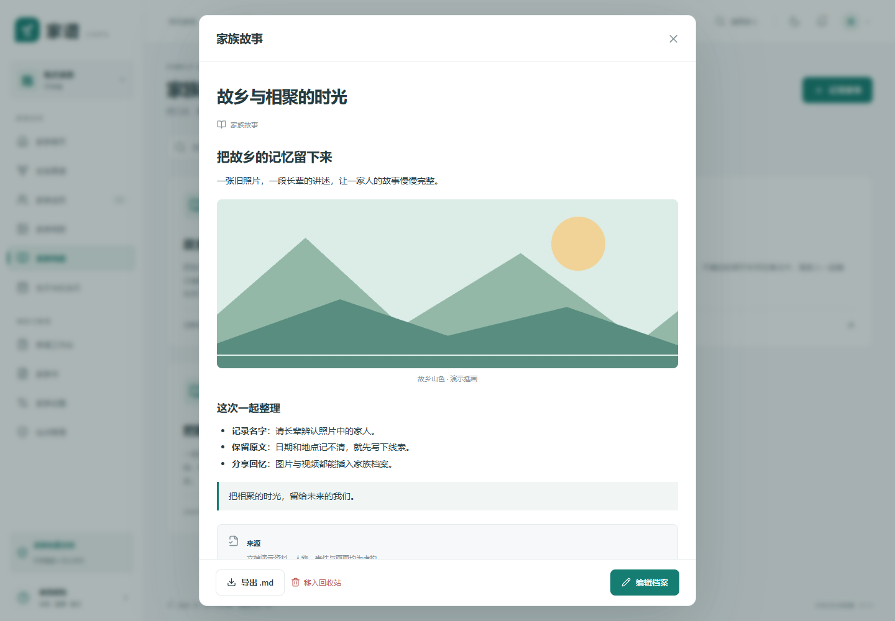
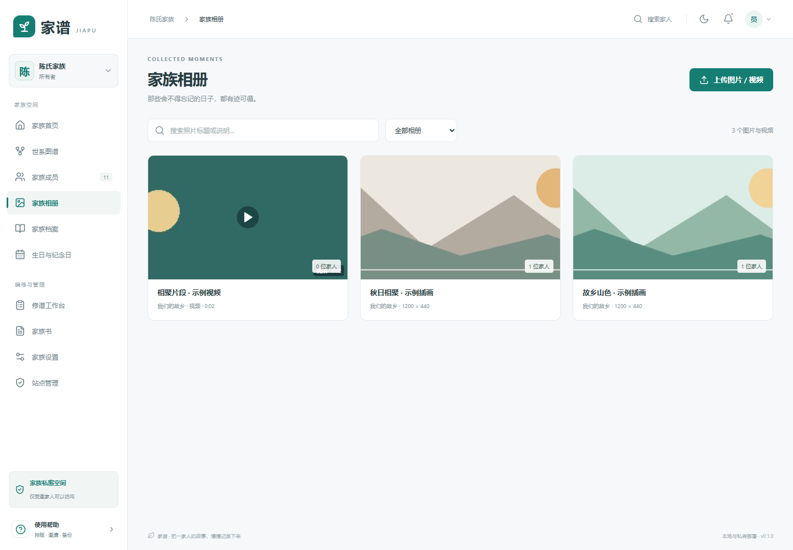
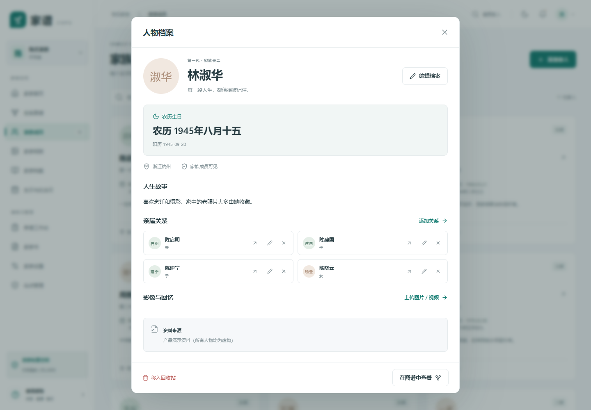
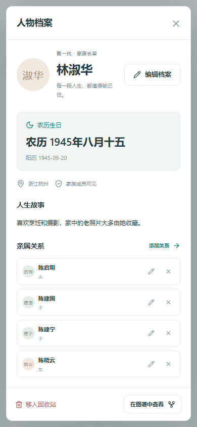
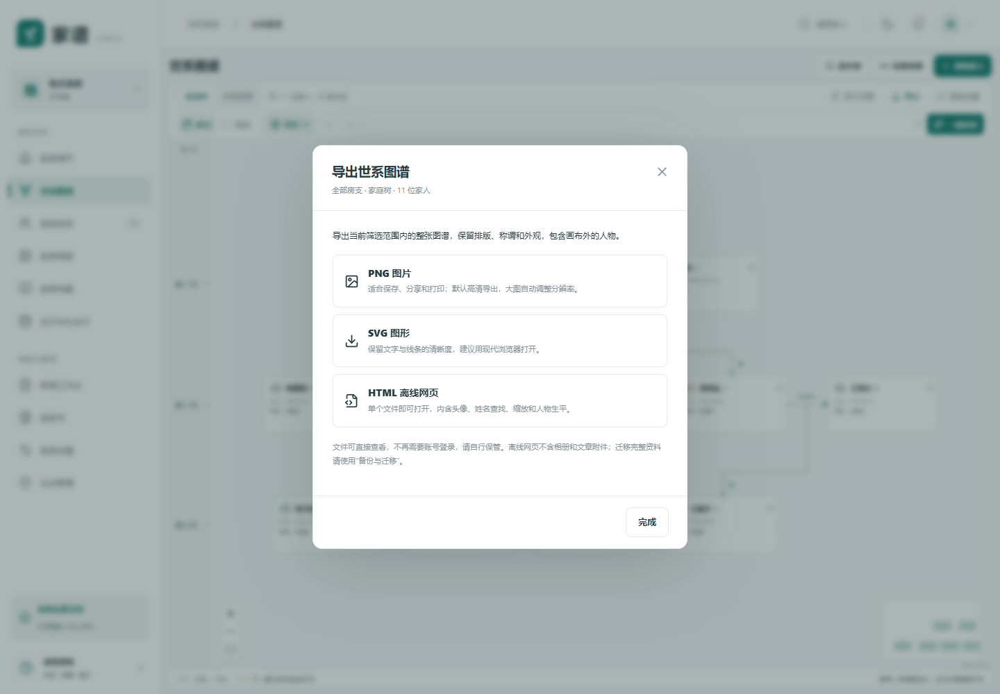
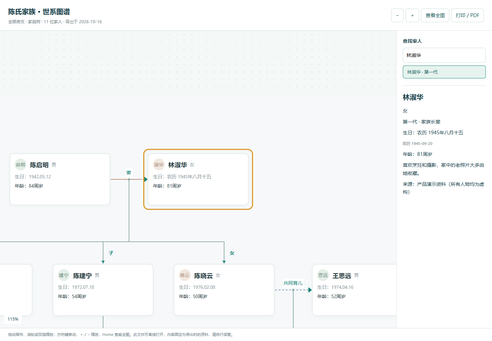

# 家谱 Jiapu

把家人的名字、亲属关系、照片与故事保存在一起。家谱是一款支持 **多账户、独立家族空间和 Docker 部署** 的家族资料管理应用，可以拖动整理世系图谱，记录农历生日，编写图文档案，也可以导出图谱图片或离线网页。

当前版本：**0.1.0**。前端使用 React / TypeScript，后端使用 FastAPI，支持 SQLite 和 PostgreSQL。



> 本文截图来自隔离的演示实例，人物、关系与故事均为虚构，图片和视频由脚本生成。仓库不包含真实账号、家族数据库或用户上传文件。

[快速运行](#快速运行) · [界面预览](#界面预览) · [导出与分享](#导出与分享) · [使用说明](docs/USER_GUIDE.md) · [Docker 部署](docs/DOCKER.md) · [常见问题](#常见问题)

## 可以做什么

| 功能 | 当前支持 |
| --- | --- |
| 世系图谱 | 家庭树 / 关系明细、按房支筛选、关系查询、世次标记、侧边称谓、人物资料预览 |
| 图谱排版 | 框选、多人拖动、吸附参考线、六种对齐、等距分布、一键排版、撤销 / 重做 |
| 人物档案 | 姓名与别名、房支 / 字辈、生平、来源、头像、在世 / 已故、隐私范围 |
| 日期 | 农历 / 阳历录入、闰月与不完整日期、生日周年规则；突出原始历法，另一历法小字备注 |
| 家族记忆 | 图片 / 视频混合批量上传、相册、关联人物、在线播放、原文件下载、图片头像裁剪 |
| 家族档案 | Markdown 编辑与预览、`.md` 导入导出、正文插图 / 视频、家族故事与资料来源 |
| 导出 | 图谱 PNG / SVG / 离线 HTML、家族书打印 / PDF、人物 CSV、加密完整备份 |
| 共同修谱 | 家族邀请、所有者 / 编辑 / 贡献者 / 只读成员、资料提报与审核、修订历史、回收站 |
| 站点管理 | 全站账号搜索 / 分页、注册与最近登录时间、所属家族、公开注册开关 |
| 界面与部署 | 电脑 / 手机适配、深色模式、大字阅读、家族主题色、Windows 启动脚本、Docker Compose |

## 快速运行

### 方式一：Docker Compose

需要 Docker Engine 或 Docker Desktop（**Linux 容器**），以及 Docker Compose **v2.20+**。首次构建需要联网下载依赖，无需在宿主机安装 Python、Node.js 或数据库。

```sh
git clone https://github.com/Breaker559/jiapu.git
cd jiapu
docker compose -f compose.sqlite.yaml up -d --build --wait
```

服务健康后，在 Docker 主机上打开 **[http://127.0.0.1:8765](http://127.0.0.1:8765)**。

```sh
# 查看服务状态
docker compose -f compose.sqlite.yaml ps

# 查看日志
docker compose -f compose.sqlite.yaml logs --tail=100 app

# 停止服务，保留数据卷
docker compose -f compose.sqlite.yaml down
```

默认使用 SQLite，数据库与媒体保存在命名卷 `jiapu_family_data`，普通停止或重建容器会保留资料。不要在需要保留资料时执行 `down -v`。

**手机、NAS、局域网或公网访问**：默认监听 `127.0.0.1`，仅供本机访问。请按 [Docker 部署说明](docs/DOCKER.md) 配置监听地址、服务器 IP / 域名、HTTPS 和允许的来源。仓库也提供 [PostgreSQL Compose](compose.yaml)，需先配置 `.env` 中的数据库密码。

### 方式二：Windows 本地运行

先安装 **Python 3.12、Node.js 22（含 npm）**；使用 Git 下载时还需要 Git。安装后在新的 PowerShell 窗口确认 `python --version`、`node --version` 和 `npm --version` 可用。

```powershell
git clone https://github.com/Breaker559/jiapu.git
cd jiapu
powershell.exe -NoProfile -ExecutionPolicy Bypass -File .\start.ps1 -OpenBrowser
```

也可以从 GitHub 下载 ZIP 并解压，双击项目中的 **[启动家谱.cmd](启动家谱.cmd)**。

首次运行会创建 Python 虚拟环境、安装依赖并构建网页。看到 `Jiapu is ready: http://127.0.0.1:8765` 后即可使用。服务在后台运行，关闭网页或启动窗口不会停止服务；停止时双击 **[停止家谱.cmd](停止家谱.cmd)**。电脑重启后需重新启动。

| 操作 | 方法 |
| --- | --- |
| 进入应用 | [http://127.0.0.1:8765](http://127.0.0.1:8765) |
| 查看只读示例 | [http://127.0.0.1:8765/?demo=1](http://127.0.0.1:8765/?demo=1) |
| 停止后台服务 | `停止家谱.cmd` 或 `powershell.exe -NoProfile -ExecutionPolicy Bypass -File .\stop.ps1` |
| 使用其他端口 | `powershell.exe -NoProfile -ExecutionPolicy Bypass -File .\start.ps1 -Port 8766 -OpenBrowser` |
| 启动日志 | `data/server.log`、`data/server-error.log` |
| 本地资料 | `data/` 目录 |

### 方式三：从源码运行

Linux / macOS 示例，同样需要 Python 3.12 和 Node.js 22：

```sh
git clone https://github.com/Breaker559/jiapu.git
cd jiapu
python3 -m venv .venv
.venv/bin/python -m pip install -r requirements.txt
npm ci
npm run build
.venv/bin/python -m uvicorn server.app:app --host 127.0.0.1 --port 8765
```

Windows 手动运行时，将 `.venv/bin/python` 替换为 `.\.venv\Scripts\python.exe`。正式页面由 FastAPI 同源提供；开发前端可另开终端运行 `npm run dev`，Vite 会将 `/api` 转发到 `8765`。

## 第一次使用

1. **初始化站点**：全新实例第一次打开时创建站点管理员。没有默认账号或密码，可选择加入虚构示例资料。
2. **保存恢复码**：忘记密码时用邮箱和恢复码重设。目前不发送验证邮件或密码找回邮件。
3. **记录家人**：添加姓名和已知日期，再用“连接亲属”分别建立父母、子女、配偶等关系。
4. **整理图谱**：拖动、框选、吸附、对齐或一键排版；在“显示设置”里筛选房支和显示称谓。
5. **补充回忆**：在首页“记忆收藏夹”或“家族相册”上传图片、视频，在“家族档案”记录故事。
6. **邀请与备份**：所有者可在“家族设置”生成邀请码、分配角色和导出完整加密备份。

初始化后，登录页提供“注册账号”。每个新注册账号创建自己的独立家族空间，不会自动加入原有家族；加入亲友家族需要邀请码。同一账号可切换多个家族。

## 界面预览

### 家族首页与记忆收藏夹

首页集中展示家人、近期生日、家族记事以及图片和视频收藏。



### Markdown 家族档案

正文支持标题、加粗、列表、引用和表格，可插入家族媒体，并在编辑与预览之间切换。



### 图片与视频

图片和视频放在同一媒体库，视频显示播放标记和时长，可关联到人物档案。



### 生日与手机阅读

农历生日重点显示农历，阳历生日重点显示阳历；换算日期放在下方作为备注。

<table>
<tr><td width="74%"></td><td width="26%"></td></tr>
</table>

## 导出与分享

### 导出图谱图片或离线网页

进入 **“世系图谱 → 导出”**，选择格式即可下载。



| 格式 | 适合用途 | 内容与说明 |
| --- | --- | --- |
| **PNG 图片** | 发给家人、保存图片、打印 | 当前筛选范围内的整张图谱，包含画布外的人物、头像、世次、称谓和连线；默认 2 倍分辨率，大图自动限制到最长边 8192 像素、约 2400 万像素以内 |
| **SVG 图形** | 在浏览器中放大阅读 | 保留文字与线条；包含 HTML 文字布局，建议用 Chrome、Edge 或 Firefox 打开，专业矢量软件的兼容性取决于软件 |
| **HTML 离线网页** | 无需部署地交给家人浏览 | 单文件内嵌图谱和头像，支持拖动、滚轮 / 双指缩放、姓名 / 房支 / 世次查找、定位人物、查看生日与生平、打印 / PDF |

导出保留**当前房支 / 关系层数筛选、家庭树或关系明细视图、称谓显示、手动排版和浅色 / 深色外观**。导出范围是当前筛选后所有可见资料，不限于屏幕内的人物，也不是仅导出框选人物。

- 导出不改变图谱位置、缩放或排版历史。
- 只能导出当前账号有权查看的资料；文件生成后可直接打开，不再需要登录，请自行保管与分享。
- HTML 是导出时的静态副本，不会随网站资料更新；不包含整个相册、文章或原始视频，也不能继续修谱编辑。
- PNG 很大时可先筛选房支；需要放大阅读时使用 SVG 或 HTML。
- 完整资料迁移请使用加密家族备份。

离线网页可双击打开，断网后也能查看：



### 其他导出格式

| 内容 | 入口 | 格式 / 用途 |
| --- | --- | --- |
| 家族档案正文 | 打开文章 → 导出 `.md` | Markdown 源文件；图片和视频保留当前家族媒体引用，不包含媒体二进制 |
| 家族纪念册 | 家族书 → 打印 / 保存 PDF | 浏览器打印或另存 PDF；文章图片保留，视频位置显示网页播放提示 |
| 人物清单 | 家族设置 → 备份与迁移 → 导出 CSV | UTF-8 CSV，可用 Excel 打开；也可按模板预览导入人物 |
| 完整家族 | 家族设置 → 备份与迁移 → 导出完整备份 | 密码加密的 `.qinpu` 文件，包含人物、关系、图片 / 视频原文件、档案和修订历史 |
| 媒体原文件 | 打开图片 / 视频 → 原图 / 原视频 | 所有者和编辑可下载上传时的原文件 |

CSV 和原文件下载开放给所有者与编辑；完整家族备份仅允许所有者导出。图谱和文章导出基于当前账号可见内容。

## 日常使用

### 图谱排版与亲属关系

- **框选**：点击“框选”后拖出选区；移动模式下按住 `Shift` 拖动也可框选。`Ctrl / ⌘` 点击增减人物。
- **拖动与吸附**：拖动人物或整组人物，参考线帮助对齐；可关闭吸附。
- **对齐与分布**：至少选 2 人可对齐，至少选 3 人可等距分布；选中后出现浮动工具栏。
- **一键排版**：按亲属关系整理当前范围内的人物。`Ctrl / ⌘ Z` 撤销，`Ctrl / ⌘ Shift Z` 重做，最多保留本次会话 30 步。
- **亲属称谓**：父、母、子、女、夫、妻等由已记录的性别和关系方向生成；所有者可在“家族设置 → 称谓设置”统一修改。
- **多种家庭关系**：父母关系分别录入，支持单亲、血缘、收养、继亲、婚姻、伴侣、前配偶及共同育儿；不会因共同育儿自动创建婚姻或血缘关系。

图谱位置按家族和筛选范围保存在**当前浏览器**，刷新后保留。不会自动同步到其他设备或进入完整家族备份；图片 / HTML 导出会保留本次排版。

### Markdown 与媒体

“家族档案 → 记录故事”默认使用 Markdown，支持 `.md` 导入、编辑预览和最多 30,000 字符的正文。旧版档案保持纯文本格式，也可手动切换为 Markdown。

在编辑器中放好光标，点击“上传图片 / 视频”直接插入，或者从已有媒体中选择后“插入正文”。正文中的 `` 引用当前家族的媒体；上传的文章附件同时保存在媒体库。

Markdown 不执行原始 HTML，不直接加载外站图片；图片需上传到家族媒体库。仅编辑可见的媒体不能放入家族成员可见的文章。媒体、文章和人物仍遵循家族访问权限。

| 文件 | 支持格式 | 单文件上限 |
| --- | --- | --- |
| 图片 | JPEG / PNG / WebP | 12 MB、3000 万像素 |
| 视频 | MP4：H.264 视频、AAC / MP3 音频；WebM：VP8 / VP9 / AV1 视频、Opus / Vorbis 音频 | 64 MB |
| Markdown | `.md` / `.markdown`，UTF-8 | 30,000 字符 |
| 加密迁移包 | `.qinpu` | 250 MB |

每家族图片和视频原文件合计上限 **128 MB**，回收站中的文件也占用容量。服务端用 Pillow 处理图片，用 PyAV 校验视频并生成封面，**不自动转码**；编码不支持时请先转换为 MP4 / H.264 再上传。

### 农历 / 阳历生日

保存原始历法和日期，不完整的日期也可录入，不会补造未知年月日。人物资料突出原始历法，生日列表按该人物选择的纪念历法计算下一次生日；支持闰月、缺失日期和约数规则。

精确换算范围为公历 **1900-01-31 至 2099-12-31**，范围外保留原文。日期按 `Asia/Shanghai` 计算。当前生日功能用于查阅，没有自动邮件、短信或系统推送。

### 账号、权限与站点后台

| 角色 | 主要操作 |
| --- | --- |
| 家族所有者 | 管理家族、邀请与权限、统一称谓、编辑资料、完整备份 |
| 家族编辑 | 整理人物 / 关系 / 档案、上传媒体、审核建议、回收站与修订恢复 |
| 资料贡献者 | 浏览可见资料、提交修改建议，由编辑审核 |
| 只读成员 | 浏览可见资料和媒体、导出可见图谱与文章 |
| 站点管理员 | 查看全站账号目录与所属家族、控制公开注册；家族内容仍按成员权限访问 |

账号操作集中在右上角头像菜单，可修改密码或退出登录；左下角“使用帮助”说明常见操作。首次初始化创建的账号是站点管理员，普通注册账号不会自动成为站点管理员。

站点管理员点击侧栏“站点管理”，可搜索账号、查看注册 / 最近登录时间和所属家族、开关公开注册。部署层 `QINPU_ALLOW_REGISTRATION=0` 可强制关闭公开注册，保留邀请码加入。当前未接入邮箱验证、多因素认证或账号停用 / 删除管理。

更多关系、日期、称谓、提报和备份规则见 **[完整使用指南](docs/USER_GUIDE.md)**。

## 数据保存、备份与升级

本地默认目录：

```text
data/
├── qinpu.db           # SQLite 数据库：账号、家族资料与修订历史
├── media/             # 图片 / 视频原文件与派生图
├── server.log         # Windows 后台运行日志
└── server-error.log   # 启动与错误日志
```

人物和媒体存储在服务器。浏览器仅保存显示偏好、图谱布局位置和上次选择的家族；清除浏览器数据会丢失本机排版偏好，不会删除服务器家族资料。

**家族迁移**：所有者导出 `.qinpu`，使用 AES-256-GCM 加密、scrypt 派生密钥。恢复前先校验和预览，随后创建新家族，不覆盖原家族；媒体编号与 Markdown 引用会一起重映射。账号、会话和邀请不会迁入。备份密码无法找回，请单独保存。

**整个实例备份**：先停止服务，再复制整个 `data/` 目录；不能只复制正在使用的 `qinpu.db` 而忽略 WAL。Docker / PostgreSQL 的卷备份与恢复命令见 [部署文档](docs/DOCKER.md#完整实例备份与恢复)。

**Windows 升级**：停止服务并备份数据后，在项目目录执行：

```powershell
git pull --ff-only
.\.venv\Scripts\python.exe -m pip install -r requirements.txt
powershell.exe -NoProfile -ExecutionPolicy Bypass -File .\start.ps1 -Rebuild -OpenBrowser
```

**Docker 升级**：完成备份后执行 `git pull --ff-only`，再运行 `docker compose -f compose.sqlite.yaml up -d --build --wait`。沿用原项目名和数据卷；旧 PostgreSQL 部署不要随意更换 Compose 项目名。

数据库当前版本为 1。后续如果改变表结构，需要正式迁移；当前没有自动升级或跨版本迁移工具。

## 常见问题

### 网页打不开

先确认服务已启动，不要直接双击 `index.html`。在 Windows PowerShell 检查：

```powershell
Invoke-RestMethod http://127.0.0.1:8765/api/health
```

- 返回 `ok: True`：访问同一端口，必要时 `Ctrl + F5` 强制刷新。
- 连接被拒绝：重新运行启动脚本，查看 `data/server-error.log`；Docker 用户查看 `docker compose -f compose.sqlite.yaml logs --tail=100 app`。
- 提示端口占用：Windows 启动时加 `-Port 8766`；Docker 修改 `.env` 中的 `QINPU_PORT`。
- 提示缺少 Python 包：在项目目录执行 `.\.venv\Scripts\python.exe -m pip install -r requirements.txt`，然后重启。
- 改代码后仍显示旧页面：重新构建前端并重启后端，再强制刷新。

### 手机上打不开 `127.0.0.1`

`127.0.0.1` 总是指当前设备，手机上这个地址指手机自己。需要按 [局域网部署说明](docs/DOCKER.md#局域网--nas) 开放监听和配置服务器 IP，再用 `http://服务器IP:端口` 访问。

### 忘记密码 / 没有注册按钮

登录页“忘记密码”使用邮箱和恢复码重设。恢复码也丢失时，由服务器维护者在服务器本机协助重置。没有邮件找回功能。

注册入口由站点管理员的注册开关和 `QINPU_ALLOW_REGISTRATION` 共同控制。关闭公开注册时，已有账号仍能登录，受邀家人仍可通过邀请码加入。

### 导出的图片不清楚，或 HTML 没有所有资料

PNG 有浏览器位图尺寸上限，可先按房支导出，或改用 SVG / HTML 放大查看。HTML 仅包含本次图谱和可见人物资料；完整图片、视频、文章与历史记录需用 `.qinpu` 备份迁移。

### Markdown 导出后图片不见了

`.md` 只保存文章源文本与家族媒体引用，单独放到其他 Markdown 软件里不会自动带上图片。迁移到另一个家谱实例时，请导出和恢复完整 `.qinpu` 家族包。

## 开发与验证

```text
src/                 React 页面、图谱、排版与离线导出
server/              FastAPI、权限、日期转换、媒体和备份
tests/               后端与图谱 / 日期逻辑测试
scripts/             浏览器验收、Docker 验收与截图脚本
docs/                使用、部署和第三方组件说明
```

Windows 验证命令：

```powershell
npm run build
.\.venv\Scripts\python.exe -m pytest tests -q
node --test tests/tree-layout.test.mjs tests/person-facts.test.mjs

# 浏览器脚本使用全局 Python 的 Playwright 与本机 Edge
python -m pip install playwright pillow
python scripts/qa_e2e.py
python scripts/qa_tree_interactions.py
python scripts/qa_tree_arrangement.py
python scripts/qa_story_media.py
python scripts/qa_tree_export.py
python scripts/qa_accounts.py
python scripts/qa_site_admin.py

# 重新生成本文截图
python scripts/capture_readme.py
```

浏览器脚本在 `test-results/` 创建隔离数据目录，使用本机 Edge；不会修改真实家族。截图脚本只使用虚构数据和程序生成的画面，结果写入 `docs/images/`。

本地已验证构建、后端测试、浏览器操作与图谱离线导出。当前开发环境没有 Docker 引擎，**容器构建、重启持久化与 PostgreSQL 运行仍需在 Docker 主机验证**；可运行 `python scripts/qa_docker.py --backend sqlite` 或 `--backend postgres`，详见 [部署验收](docs/DOCKER.md)。

## 当前边界与后续方向

当前版本适合小规模家族资料整理。家族包采用内存生成 / 解密，尚未提供超大媒体库、后台导出任务、自动备份与通知。另未实现 GEDCOM 完整交换、直接 `.xlsx` 导入、人物合并 / 拆分、迁徙地图、独立音频收藏和双向同步。

详细产品目标见 [族谱平台产品规划](族谱平台产品规划.md)，其中优先级不表示功能已经实现。第三方组件、许可证与视频依赖说明见 [THIRD_PARTY](docs/THIRD_PARTY.md)。

应用名称为“家谱 / Jiapu”。环境变量 `QINPU_*`、数据库文件 `qinpu.db` 与 `.qinpu` 家族包标识保留兼容。
